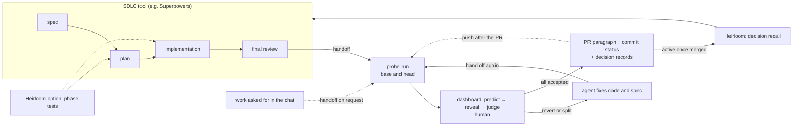

# Heirloom

[한국어](README.md)

* A plugin that checks, before merge, that a human really understands a change finished with an SDLC tool such as Superpowers.
* When the agent hands off, Heirloom itself runs probes on base and head; in a local dashboard you first predict the results, then see the actual behavior and judge it.
* The judgment goes into the PR body and a commit status; only the choices later work must keep stay in the repository, as narrow decision records.

## Where it fits in the SDLC



Of the dashed lines, phase tests work only when you turn on the [optional feature](#optional-features).

## What it does

### Handoff and probes
- When spec-based work is done, the agent hands it off. Work asked for in the chat without a spec is handed off when the user asks.
- The agent writes probes (commands) that show what the change does; once you have read and allowed every command in the dashboard, Heirloom runs them itself in temporary worktrees of base and head and records the output. Commands allowed once in a repository are not asked again. It runs the existing tests on both sides too and collects the tests whose results changed.
- From the recorded output the agent writes 3 to 5 questions and descriptions of the behavior differences. Numbers and quoted values in the descriptions must be in the actual output, and spec and conversation quotes must match their source; both are checked by machine. Claims no run confirmed are marked "no run evidence".
### Predict and judge
- In the dashboard (`http://127.0.0.1:17380/`) you predict the results first. Until you save the predictions, the server sends no observed output, and saved predictions cannot be changed.
- Once the results are revealed, you judge each question: as expected, my misunderstanding, answered, revert or split. The judgment is signed with your per-user key.
- Any revert or split sends the work back to the agent with your reasons; no PR is opened. When the same question is sent back a second time, the dashboard recommends agreeing on the design before another round of fixes.
### PR and commit status
- When everything is accepted, the agent opens the PR (an MR on GitLab) and adds the "사람이 확인한 동작" (behavior a human confirmed) paragraph, built from the signed judgment only. Wrong predictions stay in it.
- The `heirloom/understood` commit status goes on the commit that holds exactly the judged code. A commit pushed after the judgment has no status, which shows on the PR at once.
- When the code changes after the judgment, the same probes run again and only the questions whose output changed are asked again.
### Spec handling
- When a sent-back question cites spec lines, you also choose what the spec becomes: the spec is wrong, deferred, or a snapshot. For the first two, the next handoff is refused while the cited lines are unchanged.
- When everything is accepted, you choose whether to delete this work's spec after merge, move it to `docs/specs/archive/`, or keep it, so that a finished spec is not read as the current specification.
### Decision records and recall
- Only `fork` answers you choose to "keep in the repository", and decisions from PR or issue discussions you confirm as settled, are recorded in `.heirloom/decisions/`. Each record names the code and the test that hold the decision now (anchors).
- Later sessions get only the paths that decisions cover, and read the records before changing those paths. At recall, a record whose anchor is gone or whose locking test failed is marked `possibly-stale`, and the agent asks you.

## Optional features

### Tests per phase

Why: Superpowers plans run the full test suite for every task, which takes a long time ([obra/superpowers#2437](https://github.com/obra/superpowers/issues/2437)).

- The implementation plan groups its tasks into phases by their nature (same module or contract) and order.
- Each task runs only its own tests, and the full test suite runs at the end of every phase.
- The full test suite also runs before the final review and the handoff.

Add this to `<repository>/.heirloom/config.json` to turn it on. The default is `off`.

```json
{
  "schemaVersion": 1,
  "testCadence": {
    "mode": "phase"
  }
}
```

## Install

Requires Node 20 or later and git. Opening PRs also needs `gh` (GitHub) or `glab` (GitLab).

```text
# Claude Code
/plugin marketplace add cheongfish/heirloom#release
/plugin install heirloom@heirloom
```

```sh
# Codex (then trust the Heirloom hooks in /hooks in a Codex session)
codex plugin marketplace add cheongfish/heirloom@release
codex plugin add heirloom@heirloom
```

```sh
# Antigravity CLI
git clone -b release https://github.com/cheongfish/heirloom ~/tools/heirloom
agy plugin install ~/tools/heirloom
```

```sh
# Cursor CLI (name the plugin folder for each session)
git clone -b release https://github.com/cheongfish/heirloom ~/tools/heirloom
agent --plugin-dir ~/tools/heirloom
```

### What works in Cursor

Cursor is supported through its CLI (`agent`) only, and within it only the features below work.

- Works
    - Handoff, probe runs
    - Prediction and judgment in the dashboard, PR and commit status, decision records
    - Skills, the session-start context and the always-applied rule, recall of decisions in later sessions
- Does not work
    - Reminding the agent to hand off when the session ends. Cursor CLI runs no stop hook, so if the agent forgets to hand off spec-based work, nothing reminds it.
- Not checked
    - The Cursor IDE
    - Installing other than with `--plugin-dir` (marketplace, `~/.cursor/plugins/local/`)

## Documentation for agents

Installation, settings and troubleshooting can be left to your agent. The detailed documentation is written for agents in [`docs/agent/`](docs/agent/README.md).

> Read https://github.com/cheongfish/heirloom/blob/main/docs/agent/README.md, then install Heirloom on this machine and check it works.

## Requiring it for merge

The `heirloom/understood` commit status is posted on every judgment, but whether it is a merge requirement is up to each repository. Heirloom does not require it by default. With it required, a commit pushed after the judgment cannot be merged until it is judged again.

- GitHub: in the repository's Settings → Rules → Rulesets (or a branch protection rule under Branches), turn on "Require status checks to pass" for the target branch and add `heirloom/understood`. It shows up in the list only after the status was posted once.
- GitLab: a commit status posted through the API counts toward the commit's pipeline status. Turning on "Pipelines must succeed" under Settings → Merge requests makes it a merge requirement, but how this behaves in a project without CI can depend on the GitLab version and settings. Push one commit after a judgment and check that merging is really blocked.

## Records from before 0.4

Since 0.4, item-by-item approval and axioms are gone.

- Records of the old format in `.heirloom/decisions/` and `.heirloom/axioms/` are not deleted. They are no longer used as rules; they are only named as past records.
- If a decision must still hold, ask the agent, in the next work on those paths, to raise it as a `fork` question with a decision proposal, and choose "keep in the repository". Once the new record exists, the old file can be removed in an ordinary commit.
- A task that was approved item by item but never applied cannot be applied now. Hand it off again with `prepare-handoff` to have it judged.

## Good to know

- A handoff from the agent does not mean approval. Only a human can judge, and only in the dashboard.
- Probe and test commands run with your user's permissions in temporary worktrees. Every command that ran is shown in the dashboard.
- Judgments are signed with a per-user key, and the dashboard listens on `127.0.0.1` only. A program running as the same OS user can still bypass this on purpose, so Heirloom aims at detection and audit rather than prevention.
- Please tell us what you see with the [feedback form](https://github.com/cheongfish/heirloom/issues/new?template=feedback.yml).

## License

Heirloom is licensed under the [Apache License 2.0](LICENSE).

The dashboard bundles a pinned copy of [SEED Design](https://github.com/daangn/seed-design) CSS (Apache-2.0); its `LICENSE` and `NOTICE` are in `skills/using-heirloom/dashboard/vendor/seed-design/`.
