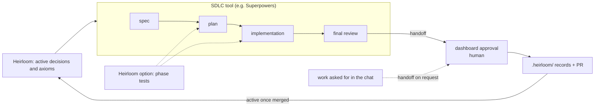

# Heirloom

[한국어](README.md)

* A plugin that wraps up work finished with an SDLC tool such as Superpowers.
* When the agent prepares a handoff, a human approves the PR summary and the decisions in a local dashboard.
* The approved records stay in the repository, the PR is opened, and later work picks the decisions up.

## Where it fits in the SDLC



Of the dashed lines, phase tests work only when you turn on the [optional feature](#optional-features).

## What it does

### Handoff
- When spec-based work is done, the agent hands it off.
- Work asked for in the chat without a spec is handed off when the user asks.
    - A decision the user made in the conversation can be recorded, quoting the user's message.
- Source quotes in its drafts (documents, the user's messages) are checked mechanically.
### Approval
- In the dashboard (`http://127.0.0.1:17380/`) you approve the summary and each decision.
- Approvals are signed.
### Records & PR
- The agent writes the records to `.heirloom/` and opens the PR (an MR on GitLab) with the approved summary.
- If the code changes after approval, only the items the change touches come back to you.
### Context management
- Later sessions start with the active decisions and rules (axioms).
- When decisions pile up, the dashboard suggests a context curation.

## Optional features

### Tests per phase
- The implementation plan groups its tasks into phases by their nature (same module or contract) and order.
- Each task runs only its own tests, and the full test suite runs at the end of every phase.
- The full test suite also runs before the final review and the handoff.

Add this to `<repository>/.heirloom/config.json` to turn it on. The default is `off`.

```json
{
  "schemaVersion": 1,
  "testCadence": {
    "mode": "phase"
  }
}
```

## Install

Requires Node 20 or later and git. Opening PRs also needs `gh` (GitHub) or `glab` (GitLab).

```text
# Claude Code
/plugin marketplace add cheongfish/heirloom#release
/plugin install heirloom@heirloom
```

```sh
# Codex (then trust the Heirloom hooks in /hooks in a Codex session)
codex plugin marketplace add cheongfish/heirloom@release
codex plugin add heirloom@heirloom
```

```sh
# Antigravity CLI
git clone -b release https://github.com/cheongfish/heirloom ~/tools/heirloom
agy plugin install ~/tools/heirloom
```

```sh
# Cursor CLI (name the plugin folder for each session)
git clone -b release https://github.com/cheongfish/heirloom ~/tools/heirloom
agent --plugin-dir ~/tools/heirloom
```

### What works in Cursor

Cursor is supported through its CLI (`agent`) only, and within it only the features below work.

- Works
    - Handoff, recording decisions made in the conversation
    - Dashboard approval, records and PR
    - Skills, the session-start context and the always-applied rule, recall of decisions in later sessions
- Does not work
    - Reminding the agent to hand off when the session ends. Cursor CLI runs no stop hook, so if the agent forgets to hand off spec-based work, nothing reminds it.
    - Running a context curation with Cursor. A curation runs with Claude Code, Codex or Antigravity.
- Not checked
    - The Cursor IDE
    - Installing other than with `--plugin-dir` (marketplace, `~/.cursor/plugins/local/`)

## Documentation for agents

Installation, settings and troubleshooting can be left to your agent. The detailed documentation is written for agents in [`docs/agent/`](docs/agent/README.md).

> Read https://github.com/cheongfish/heirloom/blob/main/docs/agent/README.md, then install Heirloom on this machine and check it works.

## Good to know

- A handoff from the agent does not mean approval. Only a human can approve, and only in the dashboard.
- Approvals are signed with a per-user key, and the dashboard listens on `127.0.0.1` only. A program running as the same OS user can still bypass this on purpose, so Heirloom aims at detection and audit rather than prevention.
- A context curation runs a headless agent only when you choose it, with the commands limited per step.
- Please tell us what you see with the [feedback form](https://github.com/cheongfish/heirloom/issues/new?template=feedback.yml).

## License

Heirloom is licensed under the [Apache License 2.0](LICENSE).

The dashboard bundles a pinned copy of [SEED Design](https://github.com/daangn/seed-design) CSS (Apache-2.0); its `LICENSE` and `NOTICE` are in `skills/using-heirloom/dashboard/vendor/seed-design/`.
