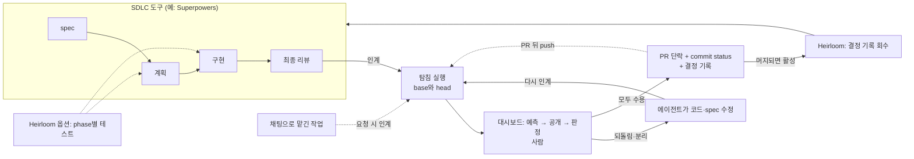

# Heirloom

[English](README.en.md)

* Superpowers 같은 SDLC 도구로 끝낸 작업을 머지하기 전에, 사람이 그 변경을 정말 이해했는지 확인하는 플러그인입니다.
* 에이전트가 인계하면 Heirloom이 base와 head에서 탐침을 직접 실행하고 사람은 로컬 대시보드에서 결과를 먼저 예측한 뒤 실제 동작을 보고 판정합니다.
* 판정은 PR 본문 단락과 commit status로 남고 다음 작업이 지켜야 할 선택만 좁은 결정 기록으로 저장소에 남습니다.

## SDLC에서의 위치



점선 중 phase별 테스트는 [선택 기능](#선택-기능)을 켰을 때만 동작합니다.

## 하는 일

### 인계와 탐침
- spec 기반 작업이 끝나면 에이전트가 인계합니다. spec 없이 채팅으로 맡긴 작업은 사용자가 요청할 때 인계합니다.
- 에이전트가 이번 변경의 동작을 드러낼 탐침(명령)을 적고 사람이 대시보드에서 허락하면 Heirloom이 base와 head에서 직접 실행해 출력을 기록합니다. 기존 테스트도 양쪽에서 돌려 결과가 달라진 테스트를 모읍니다.
- 에이전트는 기록된 출력으로 질문 3~5개와 동작 차이 설명을 씁니다. 설명 속 숫자와 따옴표 친 값이 실제 출력에 있는지, spec·대화 인용이 원문과 맞는지 기계로 검사합니다. 실행으로 확인하지 못한 주장은 "실행 증거 없음"으로 따로 표시됩니다.
### 예측과 판정
- 대시보드(`http://127.0.0.1:17380/`)에서 먼저 결과를 예측합니다. 예측을 저장하기 전에는 서버가 실제 출력을 보내지 않고 저장한 예측은 바꿀 수 없습니다.
- 결과가 공개되면 질문마다 `예상대로`, `잘못 알았음`, `답함`, `되돌림`, `분리` 중 하나로 판정합니다. 판정은 사용자별 키로 서명됩니다.
- 되돌림이나 분리가 하나라도 있으면 작업은 PR로 가지 않고 이유와 함께 에이전트에게 돌아갑니다. 같은 질문을 두 번째로 되돌리면 대시보드가 고치기를 반복하기보다 설계부터 다시 합의하길 권합니다.
- 모두 수용할 때는 이번 작업의 spec을 머지 뒤 삭제할지, 보관할지, 유지할지도 함께 고릅니다.
### PR과 commit status
- 수용한 작업은 에이전트가 PR(GitLab은 MR)로 올리고 서명된 판정에서만 만든 "사람이 확인한 동작" 단락을 본문에 넣습니다. 틀린 예측도 그대로 남습니다.
- 판정한 코드와 같은 커밋에 `heirloom/understood` commit status를 올립니다. 판정 뒤 올라온 커밋에는 이 상태가 없어 PR 화면에서 바로 드러납니다.
- 판정 뒤 코드가 바뀌면 같은 탐침을 다시 돌려서 출력이 달라진 질문만 다시 묻습니다.
### 결정 기록과 회수
- `fork` 질문의 답 중 사람이 "저장소에 계속 유지"를 고른 것, PR·이슈 토론에서 확정되었다고 사람이 확인한 것만 `.heirloom/decisions/`에 기록합니다. 기록마다 그 결정을 지금 구현하거나 잠그는 코드와 테스트(앵커)가 붙습니다.
- 다음 세션은 결정이 걸린 경로 목록만 받고 그 경로를 고치기 전에 기록을 회수합니다. 회수할 때 앵커가 사라졌거나 잠그는 테스트가 실패했으면 `possibly-stale`로 표시해 에이전트가 사람에게 묻습니다.

## 선택 기능

### phase별 테스트

계기: Superpowers 계획이 task마다 전체 테스트를 돌려 시간이 오래 걸리는 문제([obra/superpowers#2437](https://github.com/obra/superpowers/issues/2437))

- 구현 계획의 task를 성격(같은 모듈·계약)과 순서에 따라 phase로 나눕니다.
- task마다 그 task의 테스트만 돌리고 phase가 끝날 때마다 전체 테스트를 돌립니다.
- 최종 리뷰와 인계 전에도 전체 테스트를 돌립니다.

`<저장소>/.heirloom/config.json`에 다음을 넣으면 켜집니다. 기본값은 `off`입니다.

```json
{
  "schemaVersion": 1,
  "testCadence": {
    "mode": "phase"
  }
}
```

## 설치

Node 20 이상과 git이 필요합니다. PR을 만들려면 `gh`(GitHub)나 `glab`(GitLab)도 필요합니다.

```text
# Claude Code
/plugin marketplace add cheongfish/heirloom#release
/plugin install heirloom@heirloom
```

```sh
# Codex (설치 뒤 Codex 세션의 /hooks에서 Heirloom 훅을 신뢰)
codex plugin marketplace add cheongfish/heirloom@release
codex plugin add heirloom@heirloom
```

```sh
# Antigravity CLI
git clone -b release https://github.com/cheongfish/heirloom ~/tools/heirloom
agy plugin install ~/tools/heirloom
```

```sh
# Cursor CLI (CLI만 지원, 세션이 끝날 때 인계 알림 없음. 세션마다 플러그인 폴더를 지정)
git clone -b release https://github.com/cheongfish/heirloom ~/tools/heirloom
agent --plugin-dir ~/tools/heirloom
```

## 에이전트용 문서

설치, 설정, 문제 해결은 에이전트에게 맡기면 됩니다. 자세한 문서는 에이전트가 읽도록 [`docs/agent/`](docs/agent/README.md)에 영어로 정리해 두었습니다.

> https://github.com/cheongfish/heirloom/blob/main/docs/agent/README.md 를 읽고 이 머신에 Heirloom을 설치하고 확인해 줘.

## 알아 둘 점

- 에이전트가 인계해도 승인된 것은 아닙니다. 판정은 사람만 할 수 있고 대시보드에서만 합니다.
- 탐침과 테스트 명령은 대시보드에서 허락한 뒤에 내 사용자 권한으로 임시 worktree에서 실행됩니다.
- `heirloom/understood`를 머지 조건으로 걸지는 저장소마다 정합니다. 설정 방법은 에이전트용 문서에 있습니다.
- 판정은 사용자별 키로 서명하고 대시보드는 `127.0.0.1`에서만 열립니다. 다만 같은 OS 사용자 권한으로 도는 프로그램이 마음먹고 우회하는 것까지 막지는 못하므로 차단보다 탐지와 감사를 목표로 합니다.
- 겪은 일을 [피드백 양식](https://github.com/cheongfish/heirloom/issues/new?template=feedback.yml)으로 알려 주세요.

## 라이선스

Heirloom은 [Apache License 2.0](LICENSE)으로 배포합니다.

대시보드에는 고정 버전의 [SEED Design](https://github.com/daangn/seed-design) CSS(Apache-2.0)가 들어 있으며 `LICENSE`와 `NOTICE`는 `skills/using-heirloom/dashboard/vendor/seed-design/`에 있습니다.
