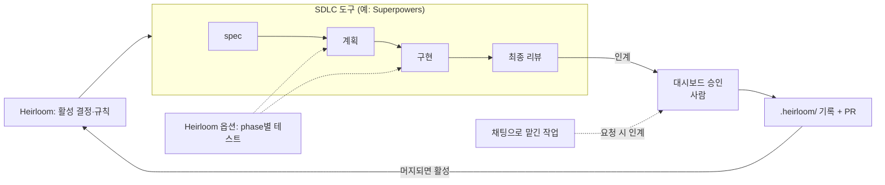

# Heirloom

[English](README.en.md)

* Superpowers 같은 SDLC 도구로 끝낸 작업을 마무리하는 플러그인입니다.
* 에이전트가 인계를 준비하면 사람이 로컬 대시보드에서 PR 요약과 결정(decision)을 승인합니다.
* 승인된 기록은 저장소에 남고 PR이 열리며 다음 작업은 그 결정을 이어받습니다.

## SDLC에서의 위치



점선 중 phase별 테스트는 [선택 기능](#선택-기능)을 켰을 때만 동작합니다.

## 하는 일

### 인계
- spec 기반 작업이 끝나면 에이전트가 인계합니다.
- spec 없이 채팅으로 맡긴 작업은 사용자가 요청할 때 인계합니다.
    - 대화에서 사용자가 정한 결정은 그 발화를 인용해 기록할 수 있습니다.
- 초안이 인용한 출처(문서, 사용자 발화)는 기계적으로 검사합니다.
### 승인
- 대시보드(`http://127.0.0.1:17380/`)에서 요약과 결정을 항목마다 승인합니다.
- 승인에는 서명이 붙습니다.
### 기록 & PR 작성
- 에이전트가 `.heirloom/`에 기록을 쓰고 승인된 요약으로 PR(GitLab은 MR)을 엽니다.
- 승인 뒤 코드가 바뀌면 바뀐 부분과 관련된 항목만 다시 확인받습니다.
### 맥락 관리
- 다음 세션은 활성 결정과 규칙(axiom)을 받고 시작합니다.
- 결정이 쌓이면 대시보드가 맥락 정리를 제안합니다.

## 선택 기능

### phase별 테스트
- 구현 계획의 task를 성격(같은 모듈·계약)과 순서에 따라 phase로 나눕니다.
- task마다 그 task의 테스트만 돌리고, phase가 끝날 때마다 전체 테스트를 돌립니다.
- 최종 리뷰와 인계 전에도 전체 테스트를 돌립니다.

`<저장소>/.heirloom/config.json`에 다음을 넣으면 켜집니다. 기본값은 `off`입니다.

```json
{
  "schemaVersion": 1,
  "testCadence": {
    "mode": "phase"
  }
}
```

## 설치

Node 20 이상과 git이 필요합니다. PR을 만들려면 `gh`(GitHub)나 `glab`(GitLab)도 필요합니다.

```text
# Claude Code
/plugin marketplace add cheongfish/heirloom#release
/plugin install heirloom@heirloom
```

```sh
# Codex (설치 뒤 Codex 세션의 /hooks에서 Heirloom 훅을 신뢰)
codex plugin marketplace add cheongfish/heirloom@release
codex plugin add heirloom@heirloom
```

```sh
# Antigravity CLI
git clone -b release https://github.com/cheongfish/heirloom ~/tools/heirloom
agy plugin install ~/tools/heirloom
```

```sh
# Cursor CLI (세션마다 플러그인 폴더를 지정)
git clone -b release https://github.com/cheongfish/heirloom ~/tools/heirloom
agent --plugin-dir ~/tools/heirloom
```

### Cursor 지원 범위

Cursor는 CLI(`agent`)만 지원하고, 그중에서도 아래 기능만 동작합니다.

- 동작
    - 인계, 대화에서 정한 결정 기록
    - 대시보드 승인, 기록과 PR
    - 스킬, 세션 시작 맥락과 상시 규칙, 다음 세션의 결정 회수
- 동작하지 않음
    - 세션이 끝날 때 인계를 다시 알려 주는 기능. Cursor CLI가 stop 훅을 실행하지 않아, spec 작업을 마치고 인계를 빠뜨려도 다시 알려 주지 않습니다.
    - 맥락 정리를 Cursor로 실행하는 기능. 맥락 정리는 Claude Code·Codex·Antigravity 중 하나로 실행됩니다.
- 확인하지 않음
    - Cursor IDE
    - `--plugin-dir` 밖의 설치 방법(마켓플레이스, `~/.cursor/plugins/local/`)

## 에이전트용 문서

설치, 설정, 문제 해결은 에이전트에게 맡기면 됩니다. 자세한 문서는 에이전트가 읽도록 [`docs/agent/`](docs/agent/README.md)에 영어로 정리해 두었습니다.

> https://github.com/cheongfish/heirloom/blob/main/docs/agent/README.md 를 읽고 이 머신에 Heirloom을 설치하고 확인해 줘.

## 알아 둘 점

- 에이전트가 인계해도 승인된 것은 아닙니다. 승인은 사람만 할 수 있고 대시보드에서만 합니다.
- 승인은 사용자별 키로 서명하고 대시보드는 `127.0.0.1`에서만 열립니다. 다만 같은 OS 사용자 권한으로 도는 프로그램이 마음먹고 우회하는 것까지 막지는 못하므로 차단보다 탐지와 감사를 목표로 합니다.
- 맥락 정리는 사용자가 고를 때만 헤드리스 에이전트로 실행되며 단계마다 쓸 수 있는 명령을 제한합니다.
- 겪은 일을 [피드백 양식](https://github.com/cheongfish/heirloom/issues/new?template=feedback.yml)으로 알려 주세요.

## 라이선스

Heirloom은 [Apache License 2.0](LICENSE)으로 배포합니다.

대시보드에는 고정 버전의 [SEED Design](https://github.com/daangn/seed-design) CSS(Apache-2.0)가 들어 있고, `LICENSE`와 `NOTICE`는 `skills/using-heirloom/dashboard/vendor/seed-design/`에 있습니다.
